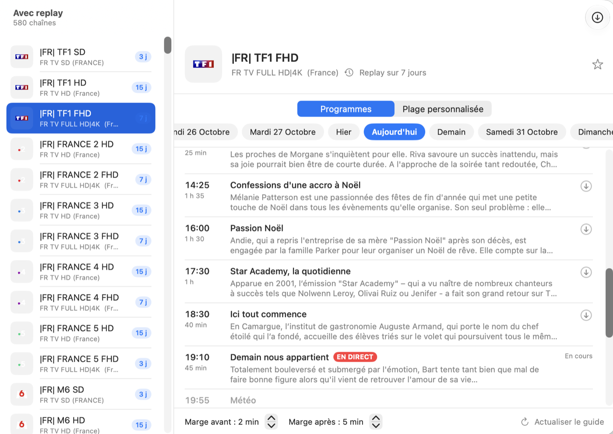

# Catchup — IPTV Catchup Downloader pour macOS

App macOS native (SwiftUI) pour télécharger les replays (catchup / `tv_archive`) d'un
abonnement IPTV compatible **Xtream Codes**, en choisissant directement les émissions dans le
guide des programmes.



> Catchup est un simple client : il ne fournit aucune chaîne ni aucun abonnement. Vous devez
> disposer de vos propres identifiants auprès d'un fournisseur, et respecter les droits des
> contenus que vous téléchargez.

## Fonctionnalités

- **Guide des programmes** : on choisit une émission dans l'EPG et on clique ⬇︎, plus besoin de taper des heures.
- **Marges** avant/après réglables (2 et 5 min par défaut) pour ne pas rater le début ou la fin.
- **Plage personnalisée** quand le fournisseur n'a pas de guide.
- **Téléchargements** dans une bulle accessible depuis la barre d'outils (comme dans un navigateur) :
  file en parallèle (1 à 4), progression, vitesse, arrêt/relance, journal FFmpeg.
- **Fichiers MP4 lisibles partout** : vidéo copiée sans perte, son converti en AAC (le MP2 de la TNT
  n'est pas lu par QuickTime), début recalé sur la première image (pas d'écran noir au démarrage).
- **Catégories, recherche, favoris**, filtre « avec replay ».
- **Décalage horaire serveur** détecté automatiquement depuis l'EPG (corrige les replays décalés d'une heure).
- Reconnexion automatique de FFmpeg en cas de coupure, notification à la fin.

## Installation

### App toute faite

1. Téléchargez `Catchup.zip` dans les [Releases](../../releases), décompressez-le et glissez
   `Catchup.app` dans **Applications**.
2. Installez FFmpeg (indispensable) : `brew install ffmpeg` (voir [Homebrew](https://brew.sh)).
3. Au premier lancement, macOS bloque l'app car elle n'est pas notarisée par Apple :
   ouvrez **Réglages Système → Confidentialité et sécurité**, puis **Ouvrir quand même**.
   Une seule fois.

Fonctionne sur macOS 14 Sonoma ou plus récent, Mac Apple Silicon et Intel.

### Depuis les sources

Prérequis : Xcode 15+ ou les Command Line Tools (`xcode-select --install`), et FFmpeg.

```bash
./build_app.sh              # → build/Catchup.app (architecture du Mac courant)
./build_app.sh --install    # → copie aussi dans /Applications
./build_app.sh --release    # → app universelle + build/Catchup.zip à joindre à une release
```

Pour développer : `swift run` lance l'app directement, ou `open Package.swift` pour l'ouvrir dans Xcode.

## Réglages (⌘,)

- **Serveur** : adresse, identifiants, format d'URL replay (si les téléchargements échouent, essayez un autre format), décalage horaire détecté.
- **Téléchargement** : dossier de destination (`~/Downloads` par défaut), marges, chemin de FFmpeg.

La configuration est enregistrée dans `~/.catchup_config.json` (compatible avec le script
`catchup_downloader.py` : si vous l'utilisiez déjà, l'app démarre directement connectée).
Ce fichier contient vos identifiants : ne le partagez pas.

## Nom des fichiers

```
NomDeLaChaine_2026-10-28_2055-2250_Titre_du_programme.mp4
```

## Licence

[MIT](LICENSE)
